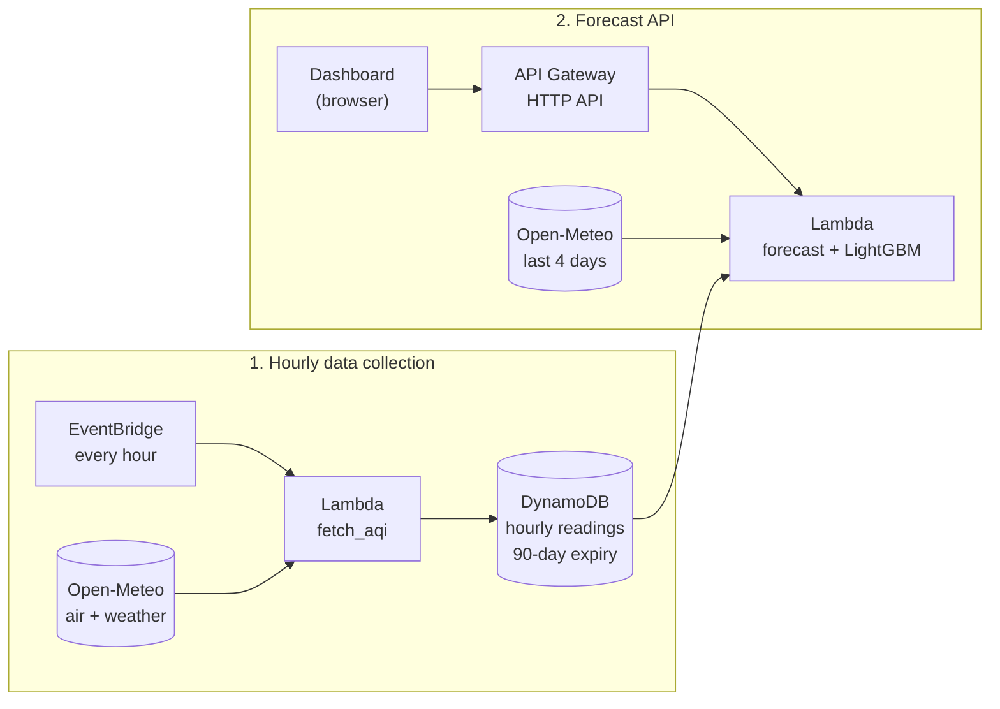

# Breathe: India Air Quality Forecaster

A serverless AWS project that tracks the **Indian CPCB Air Quality Index (AQI)** for 25 major cities and forecasts it **1, 3, 6, 12 and 24 hours ahead** using LightGBM models.


![Dashboard] 

![Forecast explorer] 


## Features

- Live AQI, pollutants and weather for 25 Indian cities
- 24-hour forecast at five horizons, shown next to recorded history
- AQI calculated on the **Indian CPCB scale** (not the US scale)
- Fully serverless: no always-on servers, designed to stay inside the AWS Free Tier
- One-file infrastructure (AWS SAM): deploy or delete the whole stack with two commands
- Model inference in pure Python, so the Lambda needs no Docker, no layers and no extra dependencies

**Cities:** Delhi, Mumbai, Bengaluru, Hyderabad, Chennai, Kolkata, Pune, Ahmedabad, Jaipur, Lucknow, Kanpur, Nagpur, Patna, Indore, Bhopal, Chandigarh, Visakhapatnam, Kochi, Thiruvananthapuram, Coimbatore, Surat, Guwahati, Bhubaneswar, Ranchi, Mangaluru.

## Architecture



| Service | Role |
|---|---|
| **AWS Lambda** | `fetch_aqi` collects data hourly; `forecast` serves the API and runs the models |
| **Amazon API Gateway (HTTP API)** | Public `/cities`, `/forecast` and `/history` endpoints, throttled to 5 requests/second |
| **Amazon DynamoDB** | Stores hourly readings per city; rows expire after 90 days (TTL) |
| **Amazon EventBridge** | Hourly schedule that triggers the collector |
| **AWS CloudFormation / SAM** | Defines and deploys all infrastructure from `backend/template.yaml` |
| **AWS IAM** | Least-privilege roles for each Lambda (created by SAM) |
| **Amazon S3** | Holds deployment packages (managed by SAM) |

## Data

- **Source:** [Open-Meteo](https://open-meteo.com/) Air Quality API (CAMS atmospheric model) and weather API. Free for non-commercial use, no API key.
- **Training data:** about 2 years of hourly history for all 25 cities.
- **Pollutants:** PM2.5, PM10, NO₂, SO₂, O₃, CO
- **Weather:** temperature, relative humidity, wind speed, surface pressure
- **Target:** the CPCB AQI, computed from 24-hour rolling averages of PM2.5 and PM10 (at least 16 of 24 hours required). The overall AQI is the higher of the two sub-indices.

| AQI | Category |
|---|---|
| 0 to 50 | Good |
| 51 to 100 | Satisfactory |
| 101 to 200 | Moderate |
| 201 to 300 | Poor |
| 301 to 400 | Very Poor |
| 401 to 500 | Severe |

> The data is **modelled**, not measured by ground stations, so values can differ from official CPCB monitors.

## Model

One LightGBM regressor per forecast horizon (1, 3, 6, 12, 24 hours), trained across all cities with the city as a categorical feature.

**Features:** current AQI, AQI lags (1, 2, 3, 6, 12, 24, 48 h), 6-hour and 24-hour rolling means, current pollutants and weather, PM2.5 24 hours ago, hour/day/month, sine and cosine of the hour, and city.

**Evaluation:** time-based split with no shuffling. The last 30 days are the test set, the 30 days before are validation (early stopping), and the rest is training. The baseline is **persistence**: predicting that the AQI stays the same.

| Horizon | MAE (model) | MAE (baseline) | RMSE (model) | RMSE (baseline) | R² (model) | R² (baseline) | Category accuracy (model) |
|---|---|---|---|---|---|---|---|
| 1 h | 0.59 | 1.07 | 0.94 | 1.84 | 1.000 | 0.999 | 99.0% |
| 3 h | 1.61 | 3.14 | 2.76 | 5.23 | 0.997 | 0.990 | 97.5% |
| 6 h | 3.52 | 6.02 | 5.90 | 9.90 | 0.987 | 0.963 | 94.7% |
| 12 h | 7.61 | 11.03 | 12.30 | 17.72 | 0.943 | 0.882 | 88.1% |
| 24 h | 15.20 | 18.27 | 23.73 | 28.38 | 0.788 | 0.697 | 77.6% |

MAE and RMSE are in AQI points. Category accuracy is how often the predicted AQI band matches the actual band.

## API

Base URL: the `ApiUrl` printed by `sam deploy`.

| Endpoint | Description |
|---|---|
| `GET /cities` | List of supported cities with coordinates |
| `GET /forecast?city=Delhi` | Current conditions plus the five-horizon forecast |
| `GET /history?city=Delhi&hours=72` | Stored hourly readings (up to 168 hours) |

Example `/forecast` response (shortened):

```json
{
  "city": "Delhi",
  "state": "Delhi",
  "as_of": "2026-11-01T16:00",
  "current": { "aqi": 154, "category": "Moderate", "pm2_5": 71.7, "pm10": 177.4 },
  "forecast": [
    { "hours_ahead": 1,  "time": "2026-11-01T17:00", "aqi": 155, "category": "Moderate" },
    { "hours_ahead": 24, "time": "2026-11-02T16:00", "aqi": 215, "category": "Poor" }
  ]
}
```

Forecasts are cached for 20 minutes per city to respect the upstream API's free quota.

## Project structure

```
aqi-forecaster/
├── backend/
│   ├── template.yaml            # SAM template: table, Lambdas, schedule, API
│   ├── fetch_aqi/               # hourly ingestion Lambda
│   │   ├── app.py
│   │   ├── aqi_utils.py         # CPCB AQI calculation
│   │   └── cities.json
│   └── forecast/                # forecast API Lambda
│       ├── app.py
│       ├── lgbm_predict.py      # pure-Python LightGBM predictor
│       ├── aqi_utils.py
│       ├── cities.json
│       └── model/               # trained models (aqi_lgbm_h*.txt + meta.json)
├── training/
│   └── train_aqi_model.ipynb    # Google Colab training notebook
├── frontend/
│   └── index.html               # static dashboard
└── docs/                        # screenshots used in this README
```

## Getting started

### Prerequisites

- An AWS account and an IAM user with programmatic access (avoid using root keys)
- [AWS CLI](https://aws.amazon.com/cli/) configured with `aws configure`
- [AWS SAM CLI](https://docs.aws.amazon.com/serverless-application-model/latest/developerguide/install-sam-cli.html)
- Python 3.12 available on your PATH

### Deploy the backend

```bash
cd backend
sam build
sam deploy --guided     # first time; later just: sam deploy
```

Suggested answers: stack name `aqi-forecaster`, region `ap-south-1`, allow IAM role creation, and save the arguments. The outputs include the `ApiUrl`.

Collect the first reading and test it:

```bash
sam remote invoke FetchAqiFunction --stack-name aqi-forecaster
curl "<ApiUrl>/forecast?city=Delhi"
```

### Run the frontend

Set the `API` constant in `frontend/index.html` to your `ApiUrl` (no trailing slash), then open the file in a browser, or serve it locally:

```bash
cd frontend
python -m http.server 8000
```

### Retrain the model

1. Upload `training/train_aqi_model.ipynb` to [Google Colab](https://colab.research.google.com/) and choose **Runtime, Run all**.
2. The notebook downloads the history, builds features, trains the five models and downloads `aqi_model.zip`.
3. Unzip it into `backend/forecast/model/`, then run `sam build` and `sam deploy`.

### Clean up

```bash
sam delete --stack-name aqi-forecaster
```

This removes every resource, including the stored history.

## Cost

Built to fit inside the AWS Free Tier: the collector runs once an hour, DynamoDB uses 5 read and 5 write units, and the API is throttled. Set up an AWS budget alert before deploying and check the Billing dashboard regularly.

## Limitations and future work

- Data is modelled (CAMS), not station readings; validating against OpenAQ or CPCB stations would strengthen the results.
- The test window is one month, so seasonal behaviour such as winter smog is not fully measured.
- The model does not yet use weather forecasts as inputs, which could improve the 12 to 24 hour horizons.
- The AQI uses PM2.5 and PM10 only; other CPCB sub-indices (NO₂, SO₂, O₃, CO) are not included.
- Only a persistence baseline has been compared so far; other models (linear regression, random forest) are a natural next benchmark.
- The API allows requests from any origin (CORS `*`); restrict it if you host the frontend on a fixed domain.

## Troubleshooting

- **`sam build` fails with "Access is denied" on Windows:** keep the project outside OneDrive or any synced folder (for example `C:\dev`).
- **Deploy fails with "Uploaded file must be a non-empty zip":** a function folder is empty or missing. Check that `backend/fetch_aqi` and `backend/forecast` contain their files.
- **Browser shows a network error but `curl` works:** a CORS problem. Make sure the deployed forecast Lambda is the latest version.

## Credits

Air quality and weather data by [Open-Meteo](https://open-meteo.com/). AQI methodology follows the Indian CPCB scale.

## Author

**Maya Kamath**
[GitHub](https://github.com/bunnyfic) · [LinkedIn](https://linkedin.com/in/mayakamath79)
